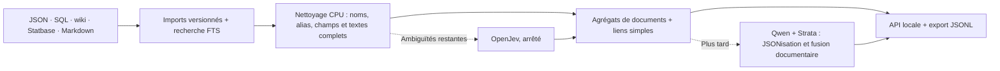

# SW D6 + DarkStryder : base unifiée pour l’agent IA

**Implémentation : `packages/sw_kbase`, revue avec Astra.** Le nettoyage courant est entièrement CPU : noms équivalents → clés d’agrégat, alias → liens textuels, équipements → liens simples. OpenJev reste arrêté et réservé aux questions restantes. **Qwen + Strata reste pour plus tard** : JSONisation et fusion rédactionnelle, avec avertissements sur les regroupements douteux. Embeddings ensuite. La vérification systématique des PDF ne bloque aucune étape.



## Schéma retenu

| Élément | Ce qu’il garde |
|---|---|
| `sources`, `records`, `record_versions` | Origine, clé native, corps brut, champs inconnus, localisation, hash et versions antérieures. |
| `entities` | Historique des identités et décisions précédentes ; conservé séparément de la clé de travail `aggregate_id`. |
| `aggregates`, `aggregate_members`, `aggregate_aliases` | Clés de navigation communes aux documents : titres normalisés, alias déclarés, variantes proches. Les identités précédemment validées sont conservées séparément. |
| `record_sections`, `aggregate_sections` | Scénarios/intrigues, informations générales, unités sources et métadonnées séparés dans la même base. |
| `aggregate_text_blocks`, `aggregate_text_sources` | Union des textes par blocs identiques, avec toutes leurs versions et positions sources ; aucune synthèse générée. |
| `aggregate_links`, `aggregate_link_evidence` | Mentions par alias exact, équipement, proximité et références sources ; passages, versions et règles CPU accessibles. |
| `profiles`, `profile_values` | Statistiques originales, valeurs D6 normalisées lorsque reconnues, édition/époque si disponibles. |
| `passages`, FTS, noms/trigrammes | Recherche immédiate et récupération de fragments bornés. |
| `document_links` | Fiches → unités citées, armes → vaisseaux, liens wiki, clés étrangères SQL/SWAPI. Une référence déclarée reste distincte d’une vérification. |
| `proposals`, `links`, `annotations` | Hypothèses et décisions séparées : identité, mentions, relations orientées, type et importance pour DarkStryder. |
| `decision_history`, `resolutions` | Réponses, décisions révisées, journal des fusions/scissions et annulations. |
| `editorial`, `syntheses` | Ajouts personnels indépendants ; paragraphes générés reliés aux imports, conflits conservés. |

Les agrégats sont volontairement permissifs. Un désaccord de type, une ancienne décision contraire ou une différence de profil reste visible et alimentera les avertissements du merger. Les textes, profils et décisions antérieures sont conservés ; aucune moyenne de statistiques ni aucun état de partie n’est déduit. Origines et univers restent étiquetés.

## Traitement effectif

**1. Import CPU.** Neuf adaptateurs couvrent les données récupérées, le wiki, Statbase, les fiches de phase 3 et les unités transcrites. Les dumps SQL sont lus, jamais exécutés. Les imports identiques sont réutilisés ; un snapshot complet retire les entrées disparues des collections effectivement relues, sans supprimer leur historique. Sans ID natif, la clé dépend du contenu plutôt que de la position dans un tableau ; un contenu modifié devient alors un nouveau record.

**2. Nettoyage CPU.** `clean` regroupe notamment Dr./Doctor, grades, ponctuation, profils datés et variantes orthographiques très proches, tout en conservant les identifiants des modèles numériques. Les alias restent indexés, mais seuls les rapprochements lexicaux forts fusionnent les clés ; un alias de classe ou d’affiliation crée un lien sans chaîne transitive d’identité. Les anciennes identités ne sont réutilisées qu’avec confirmation lexicale. Scénarios et références restent séparés. Les textes complets sont reparcourus. Les termes exacts créent des liens de navigation, même si une ambiguïté subsiste. Les champs d’équipement et les composants deviennent `has_item` ; les autres rapprochements restent `related`. Le nom le plus long reconnu évite les liens parasites vers un sous-terme.

**3. Réduction des questions.** Les comparaisons internes aux clés et les liens lexicaux ne sollicitent plus de modèle. Les collisions de noms faibles sont classées sans suite, sans prétendre prouver une différence d’identité. Les types récupérables des sources sont repris ; l’utilité de fusion est reportée au merger. Les propositions et leur ancien statut restent auditables dans `cleaning_decisions`. Les cas encore proches mais non regroupés, types inconnus, univers et importance restent à examiner. Les routines OpenJev par tuples/choix existent pour une éventuelle reprise ; elles ne sont pas lancées.

**4. Union textuelle CPU puis Qwen + Strata.** `aggregate_text_blocks` déduplique les blocs identiques après normalisation des espaces ; leurs occurrences restent localisées dans chaque version source. Les formulations et chiffres différents restent côte à côte. La rédaction et résolution des contradictions appartiennent ensuite à Qwen + Strata. Aucun appel pendant cette passe. La synthèse devra consommer les clés d’agrégat, garder les profils et signaler les avertissements. L’ancienne interface `compose` par identité stricte reste distincte ; son adaptation aux agrégats et la JSONisation détaillée du Markdown sont pour plus tard.

## Utilisation et reprise

Base hors dépôt, chemin réglé par `database` dans la configuration locale ; les fichiers de travail peuvent être placés sur SSD. Les JSON du site et l’ancienne KBase restent indépendants. Aucune nouvelle transcription n’est déclenchée.

```powershell
npm run sw:kb -- ingest
npm run sw:kb -- clean
npm run sw:kb -- status
npm run sw:kb:serve
```

`config/phase4.local.json` est reconnue automatiquement ; `config/sw-kbase.local.json` prend priorité. Sinon copier [l’exemple](../config/sw-kbase.example.json), puis renseigner les IDs/révisions et URL réels. Le [lanceur WSL](sw-d6-openjev-operations.md) sert Qwen 27B à OpenJev. `curate` reprend la file et écrit `openjev-progress.json` dans le runtime. `pause` demande un arrêt entre lots ; `resume`, puis `curate --continuous`, reprend. `writer_enabled: false` bloque Strata. `split --id <record>` et `undo --id <événement>` journalisent les corrections. Un changement de contrat se fait par une transition explicite (`continue-contract`) ; les anciennes décisions restent auditables.

L’acquisition web reprend avec `python tools/sw-kbase/acquire-web.py --output <external-root>/web-2026-10-22`. Les réponses brutes et leurs hashes restent hors Git ; les sources bloquées sont listées dans le bilan d’acquisition.

API sur **127.0.0.1:8765** : `/aggregates?section=reference|scenario&duplicates=1`, `/aggregates/<id>/text`, `/search?q=...`, `/entities/<id>`, `/records/<id>`, `/passages?record_id=...`, `/status`. Réponses paginées, profils et liens de navigation. `export --reference-only --output <nouveau-dossier>` produit records, passages, profils et liens en JSONL avec manifeste de hashes, sans vecteurs ; omettre le drapeau inclut les journaux de curation. L’ancienne entrée accepte aussi `npm run transcripts:phase4 -- --unified status`.

L’explorateur **http://127.0.0.1:8765/review#browse** propose les agrégats par type et section, le filtre des doublons, les nombres de documents/sources, les textes agrégés, les voisins et les passages justifiant chaque lien. `aggregates` est la clé de travail courante ; `entities` conserve les anciennes décisions séparément. Les liens automatiques sont des aides de navigation révisables. Une sauvegarde SQLite précède le nettoyage réel ; les originaux et les ajouts personnels restent intacts.
